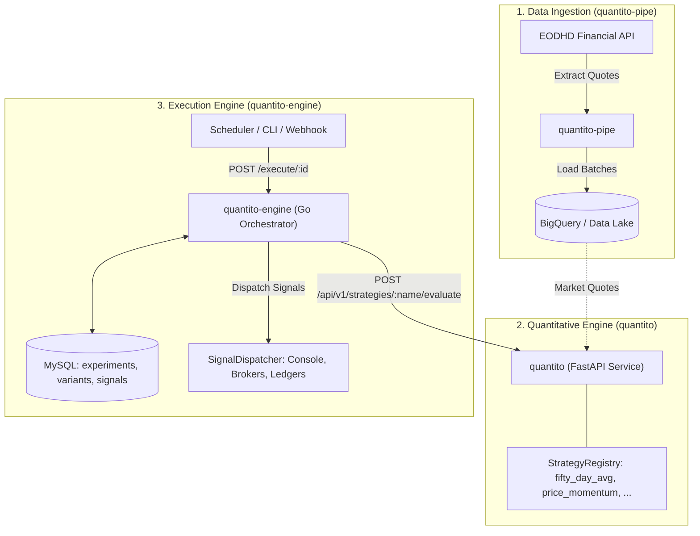

# Quantito Engine (`quantito-engine`)

**Quantito Engine** is the execution, orchestration, and benchmarking engine of the **Quantito Financial Platform**. Built with Go (1.22+) and Echo, it orchestrates quantitative experiments, evaluates strategies under a parallel contraposition model, maintains historical signal ledgers, and dispatches actionable trade recommendations to active sinks.

---

## 1. Role in the Quantito Ecosystem

The **Quantito Platform** is partitioned into three decoupled services:



| Service | Technology | Role |
| :--- | :--- | :--- |
| **`quantito-pipe`** | Python / Cloud Run Job | Ingests market quotes (EOD, Delayed, Real-time) from EODHD into BigQuery. |
| **`quantito`** | Python 3.12 / FastAPI | Pure quantitative strategy evaluation service (`fifty_day_avg`, `price_momentum`). |
| **`quantito-engine`** *(this repo)* | Go 1.22+ / Echo / MySQL | Experiment orchestrator, parallel contraposition, concurrency locks, signal ledger, and dispatcher. |

---

## 2. Core Architecture & Responsibilities

1. **Parallel Contraposition Execution**: Concurrently evaluates all strategy variants belonging to an experiment across identical asset universes, guaranteeing unbiased comparative performance tracking.
2. **Experiment & Asset Universe Management**: Organizes experiments (`experiments`), associates eligible assets (`experimentAssets`), and configures strategy variants (`variants`).
3. **Delegated Strategy Evaluation**: Calls the **`quantito`** strategy service over HTTP REST (`POST /api/v1/strategies/:name/evaluate`) via `IAPIClient`, keeping strategy algorithms decoupled from orchestration logic.
4. **Signal Ledger**: Persists evaluation results, market prices, confidence metrics, and emitted signals (`BUY`, `HOLD`, `SELL`) in the MySQL `signals` table.
5. **Signal Dispatching**: Routes emitted signals through an extensible `SignalDispatcher` to active sinks (e.g. `ConsoleSink`, broker APIs, notification services).
6. **Concurrency Protection**: Enforces mutual exclusion (`ExecutionMutex` / `KeyMutex`) per experiment to prevent overlapping or race conditions during execution runs.

---

## 3. Key Domain Concepts

### Experiments & Contraposition

- **Experiment**: The root unit of orchestration. Defines participating assets and executes all assigned variants concurrently.
- **ExperimentAsset**: Associates an asset (`AssetID`) to an experiment (`ExperimentID`), defining the asset universe.
- **Variant**: Represents a specific strategy configuration competing within an experiment.

### Strategies & Signals

- **Strategy**: Pluggable quantitative algorithm (e.g. `fifty_day_avg`, `price_momentum`). Evaluated via external API request to `quantito`.
- **Signal**: Standardized recommendation produced by strategy evaluation:
  - `Type`: **`BUY`**, **`HOLD`**, or **`SELL`**.
  - `Price`: Asset price at the time of evaluation.
  - `Confidence`: Confidence score from $0.0$ to $1.0$.
  - `Timestamp`: UTC timestamp of the evaluation.

### Sinks & Dispatcher

- **ISignalSink**: Pluggable destination for emitted signals (e.g. `ConsoleSink`, `BrokerSink`).
- **ISignalDispatcher**: Central router iterating over registered sinks to dispatch emitted signals.

### Historical Ledger

- **SignalRecord**: Persisted in the `signals` table recording the complete audit trail: experiment ID, variant ID, asset ID, signal type, price, confidence, and execution timestamp.

---

## 4. Configuration

The application is configured via `.dev/config.toml` or environment variables:

```toml
# Web server configuration
[api]
listen = ":8080"
quantito_url = "http://localhost:8081"   # Base URL of quantito FastAPI service

# Database connection
[database]
host = "localhost:3306"
schema = "quantito-engine"
username = "quantito_user"
password = "quantito_password"

# Logging configuration
[log]
level = "debug"                         # "debug" | "info" | "error"
logger = "console"                      # "console" | "split-json" | "json"
```

### Environment Variable Overrides

| Variable | Description | Default |
| :--- | :--- | :--- |
| `API_LISTEN` | HTTP port for Echo server | `:8080` |
| `QUANTITO_API_URL` | Base URL for `quantito` strategy service | `http://localhost:8081` |
| `DB_HOST` | MySQL hostname and port | `localhost:3306` |
| `DB_SCHEMA` | MySQL schema name | `quantito-engine` |
| `DB_USER` | MySQL user | `quantito_user` |
| `DB_PASSWORD` | MySQL password | `quantito_password` |
| `LOG_LEVEL` | Logging verbosity | `debug` |

---

## 5. API Endpoints

### Execute Experiment
```http
POST /execute/:id
```
Executes all variants of experiment `:id` across its associated assets, fetches evaluation from `quantito`, records emitted signals to MySQL, and dispatches them to active sinks.

---

## 6. Local Development & Makefile Commands

A standard [Makefile](./Makefile) provides shortcuts for local development, testing, and Docker Compose orchestration:

| Command | Description |
| :--- | :--- |
| `make up` | Spin up all services (`mysql` and `quantito-engine`) with Docker Compose in background. |
| `make up-local` | Run `quantito-engine` directly on host using local Go runtime. |
| `make down` | Stop and tear down Docker Compose containers. |
| `make prepare-integration-tests` | Spin up MySQL container for integration test suite. |
| `make integration-tests` | Run integration tests (`go test -v ./tests/...`). |
| `make unit-tests` | Run all unit tests (`go test -v ./internal/... ./cmd/...`). |
| `make test` | Run both unit and integration tests. |
| `make help` | Display available targets. |

### Running Tests

```bash
# Run unit tests
go test ./internal/... ./cmd/...

# Run integration tests (requires MySQL running)
make prepare-integration-tests
make integration-tests
```
